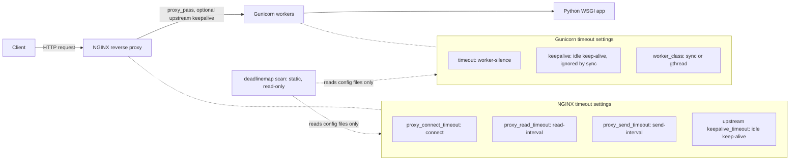
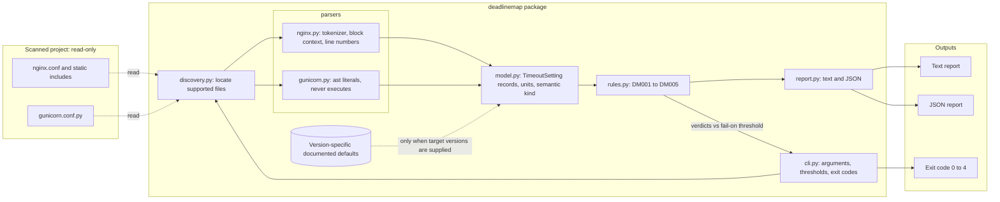
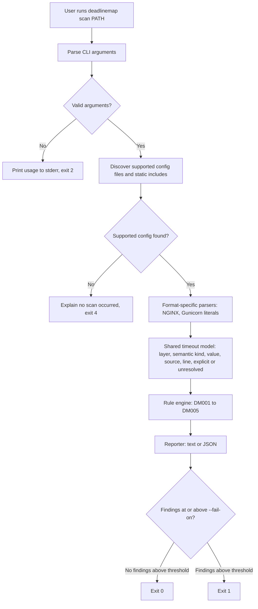
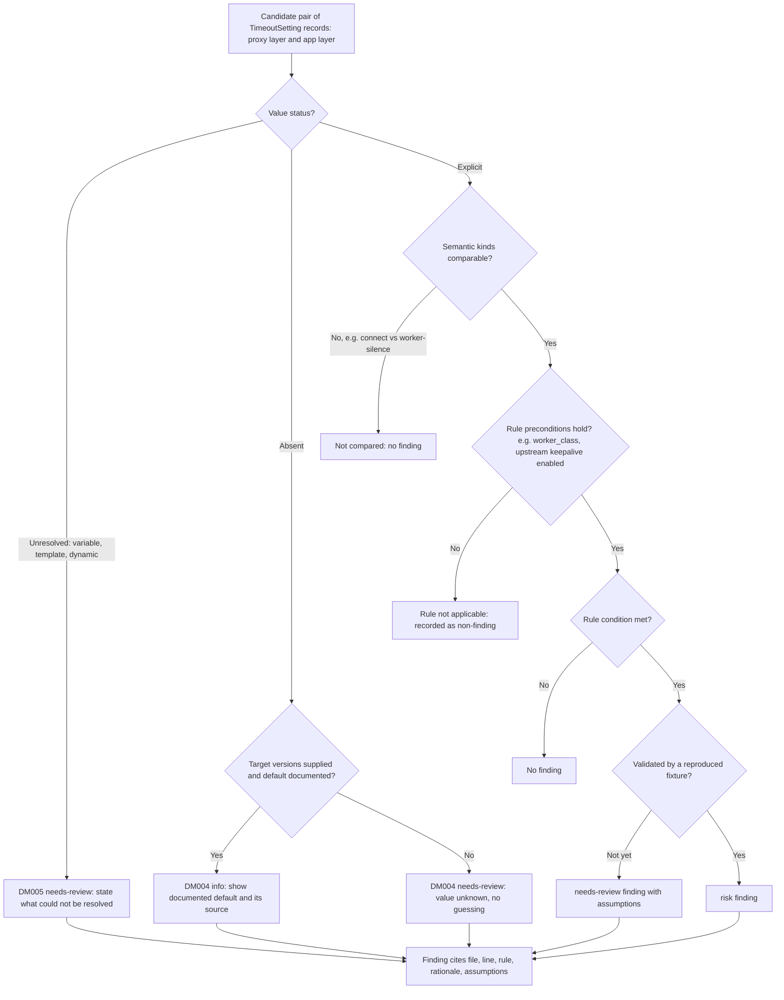
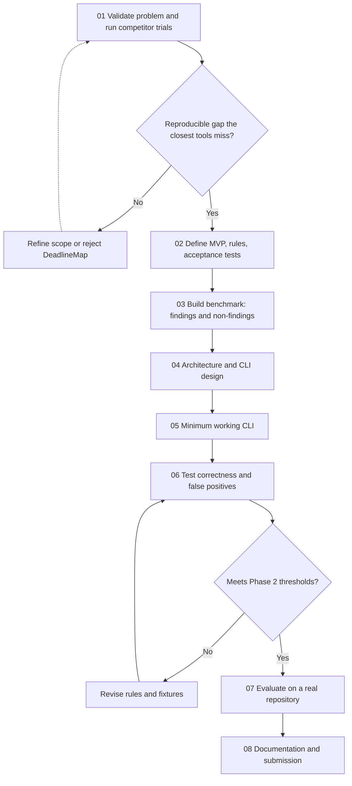

# DeadlineMap

A cross-layer timeout configuration analyzer: a read-only Python CLI that inspects configuration along a request path (reverse proxy → application server) and reports timeout risks with file-and-line evidence from the source files.

**Team:** `<Name 1>` (Roll No: `<…>`), `<Name 2>` (Roll No: `<…>`)
**Repository:** `https://github.com/REPLACE_WITH_USERNAME/deadlinemap`

**Date:** 29-10-2026

> **Core principle:** analyze configuration, explain possible failures, and never automatically change the developer's files.

> **Evidence status:** This is a project proposal. The public reports are leads with varying levels of causal certainty; no local failure reproduction or competitor trial is claimed yet. The gap statement and metric targets remain hypotheses until Phase 1/2 evidence is collected.

---

## 1. The problem

A single HTTP request in a typical deployment may pass through several layers, each with timeout settings configured in different files and with different units, defaults, and meanings. Poorly coordinated settings **can contribute to** premature `502 Bad Gateway` / `504 Gateway Timeout` responses, worker restarts, or work continuing after a caller has stopped waiting; the exact outcome depends on the server, worker type, traffic pattern, and timeout semantics.

When a developer investigates such a stack, they need answers to:

1. Which timeout settings exist along this request path, and in which files and lines?
2. Which values are set explicitly, and which are silently inherited defaults?
3. Does an outer layer give up before (or after) an inner layer, and is that intended?
4. Are two values being compared that actually mean different things (connect vs. read vs. total vs. idle keep-alive)?
5. Which relationship is genuinely broken, and which merely **needs review**?

No single file answers these questions; the developer has to mentally join the proxy configuration with the application-server configuration.

### Manual workflow to validate

**Hypothesis to validate in Phase 1:** a developer inspects the proxy and application-server settings separately, then compares values manually. The commands below are a proposed starting point, not a claim that a team member has already run this exact sequence. Replace them with the actual commands observed on a real project before final submission.

```bash
grep -rnE "proxy_(connect|read|send)_timeout|keepalive_timeout|send_timeout" nginx/
grep -nE "timeout|keepalive|keep_alive|graceful|worker_class" gunicorn.conf.py
```

The review may then require the developer to:

- look up each layer's default for every setting that is **not** present,
- normalise units (`60s`, `1m`, `30`, `30000ms`),
- remember that NGINX's `proxy_read_timeout` is the allowed interval **between two successive reads** from the upstream, not a total response deadline, while `proxy_connect_timeout` only limits connection establishment,
- account for worker type: Gunicorn's `timeout` is documented as a worker-silence timeout, and its behavior differs between sync and non-sync workers; the `keepalive` setting is ignored by the sync worker.

This workflow is a **problem hypothesis**, not yet a measured result. It may be error-prone because the numbers look comparable even when their semantics are different. Phase 1 must record one real manual run and its elapsed time.

### Evidence that this is real

> **Status: partial desk evidence; local evidence is still required.** The public reports below show that timeout relationships are discussed in real deployments, but they do not all establish a confirmed root cause. Do not describe them as proven reproductions.

- [x] **Kubernetes ingress-nginx issue #11244:** the reporter suspected an idle keep-alive mismatch between NGINX (`keepalive_timeout 75s`) and an OpenLiberty backend (`persistTimeout 60s`); the reporter explicitly remained uncertain about the diagnosis. https://github.com/kubernetes/ingress-nginx/issues/11244
- [x] **Dify discussion #31746:** a workflow timeout discussion raised a possible frontend/backend/Gunicorn/NGINX timeout mismatch. The automated reply is a diagnostic suggestion, not maintainer-confirmed root-cause evidence. https://github.com/langgenius/dify/discussions/31746
- [x] **Community Health Toolkit report #4627:** a 504 timeout was discussed alongside NGINX timeout settings, but the poster was unsure whether the configuration explained the failure. Treat this as a lead, not proof of a mismatch. https://forum.communityhealthtoolkit.org/t/gateway-timeouts-on-password-reset/4627
- [ ] Reproduce at least **one** supported failure locally in an isolated fixture and paste the actual terminal output / log lines.
- [ ] Record the elapsed time for the actual manual inspection on a real repository. Do not estimate.

### Who else has this problem

**Target-user hypothesis:** developers maintaining a web application behind a reverse proxy, especially small teams using NGINX and Gunicorn who need to debug intermittent `502`/`504` responses or idle-connection failures. This audience has not yet been interviewed for this project.

> **TODO:** Ask two developers/classmates how they diagnose timeout issues and record their exact words, with permission. Do not invent quotes or claim the problem is widespread until those interviews happen.

---

## 2. Prior art — what already exists

The first-pass search found strong adjacent tools, but has **not yet established the absence of a direct competitor** that performs cross-layer timeout analysis. The tools below are baselines to evaluate; several are not direct competitors and must not be treated as proof of a gap.

### Tools to evaluate (not yet locally trialled)

| Tool | Where we found it | What it does | How it relates to DeadlineMap |
|---|---|---|---|
| Gixy | https://github.com/yandex/gixy | Static analyzer for NGINX configuration, focused mainly on security and configuration problems. | An NGINX-focused baseline. Test whether any existing checks cover timeout semantics; do not assume they do not. |
| Checkov | https://github.com/bridgecrewio/checkov | Policy-as-code scanner for infrastructure-as-code and supported configuration formats. | Adjacent baseline for supported infrastructure files; relevance depends on what its current checks cover. |
| kube-linter | https://github.com/stackrox/kube-linter | Lints Kubernetes manifests for common configuration and deployment practices. | Relevant only if Kubernetes manifests are part of the fixture; not a like-for-like comparison for an NGINX/Gunicorn config pair. |
| `nginx -t` | NGINX-provided configuration test | Checks whether the NGINX configuration parses/loads. | Syntax baseline, not a cross-layer analyzer. |
| `gunicorn --check-config` / `--print-config` | Gunicorn-provided configuration checks | Checks Gunicorn configuration; `--print-config` prints resolved settings. | Application-server baseline. Test whether explicit configuration/default information can be harvested, but it does not by itself establish a cross-layer gap. |
| Direct timeout/configuration analyzers | GitHub, PyPI, npm, Homebrew search still in progress | Unknown until searched and inspected. | These are the most important candidates for the novelty assessment. Do not skip this search. |

### Evidence of trying them

> **TODO (Phase 1):** No tool trial is claimed yet. Install each relevant candidate in an isolated environment, record its version, exact command, unedited output, and the finding (or non-finding) against the same logical test cases. Where a tool cannot parse the format, record that as a scope limitation rather than as proof that DeadlineMap is better.

### Controlled fixture plan

Use separate fixtures so each rule is tested against the worker type and directives it actually depends on. These are **candidate cases**, not yet validated failures.

**Fixture A — possible upstream idle keep-alive mismatch** (`worker_class = "gthread"` is explicit because Gunicorn's sync worker ignores `keepalive`):

```nginx
# nginx.conf -- fixture only
events {}
http {
    upstream app_server {
        server 127.0.0.1:8000;
        keepalive 16;
        keepalive_timeout 60s;
    }
    server {
        listen 8080;
        location / {
            proxy_pass http://app_server;
            proxy_http_version 1.1;
            proxy_set_header Connection "";
            proxy_read_timeout 120s;
        }
    }
}
```

```python
# gunicorn.conf.py -- fixture only
worker_class = "gthread"
workers = 2
threads = 4
keepalive = 2
timeout = 30
```

This tests whether a longer NGINX upstream idle-cache timeout than the backend's persistent-connection idle timeout should produce a **review finding**. It must not be labelled a confirmed runtime failure until reproduced. The `keepalive_timeout` directive in the upstream context requires NGINX 1.15.3 or later. Pin or record NGINX and Gunicorn versions, because defaults and worker behavior are version-/type-dependent; these fixtures explicitly set the relevant keep-alive and HTTP proxy options so the test does not rely on their defaults.

**Fixture B — worker timeout vs. proxy read interval:** set `worker_class = "sync"`, `timeout = 30` in Gunicorn and `proxy_read_timeout 120s` in NGINX. Treat this as a potential risk only for a request that leaves the sync worker silent long enough; do not claim a guaranteed status code without reproducing it.

**Fixture C — proxy read interval expires first:** set `worker_class = "sync"`, `timeout = 120` and `proxy_read_timeout 30s`. Test whether NGINX closes an idle response before the worker timeout and whether the application continues work. This depends on response behavior and application cancellation semantics.

**Control cases:** include configurations where the relevant mechanism is disabled, the worker type makes a rule inapplicable, or settings are dynamic/unknown. The expected result for these controls must be documented before running the scanner; do not label every numeric mismatch a fault.

```text
Trial 1: <tool and version> <exact command> -> <actual output>
Evaluation: <what it found, missed, or could not parse>

Trial 2: <tool and version> <exact command> -> <actual output>
Evaluation: <what it found, missed, or could not parse>

Trial 3: <tool and version> <exact command> -> <actual output>
Evaluation: <what it found, missed, or could not parse>
```

### Where we searched

- [x] Official NGINX proxy and upstream documentation.
- [x] Official Gunicorn settings documentation.
- [x] Initial GitHub searches for NGINX/Gunicorn timeout linting and configuration analysis; direct-competitor search remains incomplete.
- [x] Initial public-incident search; reports are listed in Section 1 with uncertainty noted.
- [ ] `man -k timeout` and installed tool availability on the development machine.
- [ ] Broader GitHub repository and issue searches, including terms for timeout consistency, upstream idle connections, proxy/backend config comparison, and deadline analysis.
- [ ] PyPI / npm / Homebrew searches for direct timeout analyzers.
- [ ] Install and run at least three relevant tools against the fixtures.
- [ ] Interview two developers/classmates; record genuine notes or quotes with permission.

### The gap, in one sentence

**Hypothesis only — do not submit as a proven result:** Existing tools may validate individual configurations or cover separate infrastructure policies, while a small static CLI could connect explicit NGINX upstream-timeout settings to a supported Gunicorn worker configuration, classify the semantics, and cite both source locations. Phase 1 must establish whether any existing tool already does this adequately.

> **Gate:** Proceed only if a reproducible, technically valid fixture exposes a meaningful limitation in the closest alternatives. If an existing tool already identifies the same issue with acceptable accuracy, refine or reject DeadlineMap.

---

## 3. What we are building

`deadlinemap` is a read-only Python CLI that discovers timeout-related configuration in a project, maps it onto a shared timeout model, applies a small set of explicitly defined rules, and prints findings that cite the file, line, rule, and rationale.

### In scope (v1)

- **One request path:** NGINX → Gunicorn. The initial implementation will support only documented configuration constructs that can be statically resolved.
- **Configuration discovery:** Finds a top-level NGINX config and statically resolvable `include` files, plus `gunicorn.conf.py`. Parsing Procfile/Dockerfile command lines is deferred unless Phase 2 shows it is necessary.
- **Semantic timeout model:** Classifies supported values as *connect*, *read-interval*, *send-interval*, *worker-silence*, or *idle keep-alive*, normalises units, and records source, line, and whether a value is explicit.
- **Version-aware defaults:** Do not silently assume defaults when target versions are unknown. Show defaults only when a target version is provided and the relevant official default is documented; otherwise report the setting as unknown/needs-review.
- **Rule engine with three verdicts:** `risk`, `needs-review`, and `info`. The initial rule set should prefer `needs-review` unless a risk is supported by a validated, specific rule.
- **Evidence-backed output:** Human-readable text and JSON; each finding includes source file(s), line(s), rule ID, explanation, and any assumptions.

### Planned rules (each must have a technical reason and evidence requirement)

| Rule | Condition | Initial verdict | Why it matters / safety condition |
|---|---|---|---|
| DM001 | NGINX upstream idle keep-alive caching is explicitly enabled; its upstream `keepalive_timeout` exceeds Gunicorn's `keepalive`; and the configured worker type supports persistent connections (initially test `gthread`). | `needs-review` until reproduced | The proxy may retain an idle upstream connection longer than the server's configured keep-alive period. A stale-connection race is a hypothesis, not a guaranteed `502`; verify against a pinned server version and a controlled runtime test. Do not apply this rule to Gunicorn `sync` workers. |
| DM002 | Explicit `worker_class = "sync"`; Gunicorn `timeout` is shorter than NGINX `proxy_read_timeout`; the request may leave the worker silent. | `needs-review` | A sync worker may be killed before NGINX reaches its read-interval timeout. The result depends on request/response behavior; do not promise a specific HTTP status. |
| DM003 | NGINX `proxy_read_timeout` is shorter than Gunicorn's `timeout` for an explicitly supported sync-worker configuration, with a response that may remain silent. | `needs-review` | NGINX may close the upstream request before Gunicorn's worker timeout. Whether application work continues depends on the app and worker behavior; do not claim it always continues. |
| DM004 | A supported setting is absent. | `info` only when applicable version defaults are known; otherwise `needs-review` | Make implicit configuration visible without inventing defaults. Do not infer target versions from the developer machine. |
| DM005 | A setting uses unsupported syntax, variables, templates, dynamic expressions, or an unparseable value. | `needs-review` | State exactly what could not be resolved and do not guess. |

### Out of scope

- **Automatic fixes:** DeadlineMap never edits, installs, restarts, or sends requests to anything.
- **Generic configuration linting / security checks:** not the purpose of DeadlineMap; existing tools such as Gixy, Checkov, and kube-linter are adjacent baselines, not proof that the timeout-analysis gap is solved or unsolved.
- **Other proxies and stacks** (HAProxy, Envoy, Traefik, uWSGI, Node, Java) in v1.
- **Runtime measurement:** no load testing, tracing, or production probing; analysis is purely static.
- **Cloud load balancers / Kubernetes ingress annotations** in v1.

### How we will know it worked

The proposed success criterion is that DeadlineMap can replace a verified manual grep/look-up/compare routine with **one command** (`deadlinemap scan ./project`) and meets the targets below on our benchmark. *(Proposed targets, to be finalized in Phase 2 — not measured results.)*

| Metric | Initial target |
|---|---|
| Known benchmark issues detected | Target: ≥ 90% recall over at least 20 supported positive cases; not yet measured |
| False positives | Target: ≤ 5% of at least 20 documented non-applicable/control cases; not yet measured |
| Explainability | Every finding links to source file(s), line(s), rule, assumptions, and rationale |
| Safety | No automatic edits, installs, restarts, or production requests |
| Reproducibility | Tests and benchmark run with documented commands and pinned fixture versions |

The benchmark must also cover distinct timeout semantics and state clearly which cases the tool does **not** support.

---

## 4. Tech stack

| Choice | What we picked | Why, and what we rejected |
|---|---|---|
| Language | Python 3.11+ | Good support for filesystem tooling, parsing, and automated tests; Gunicorn configs are themselves Python. Rejected Bash (too fragile for real parsing) and Go/Rust (build/distribution overhead for a student project). |
| Argument parsing | `argparse` (stdlib) | Minimal dependencies and a straightforward subcommand interface. |
| Parsing | Small, dedicated NGINX tokenizer/parser; Python `ast` for literal assignments in `gunicorn.conf.py` | Preserves block context and line numbers for supported constructs. `ast.parse` reads Python syntax without executing the configuration; dynamic expressions are reported as unresolved. |
| Testing | `pytest` with fixture repositories | Repeatable positive, negative, and edge-case fixtures with expected findings and non-findings. |
| Output | Human-readable text and JSON | Useful interactively and in CI scripts. |
| Packaging / install | Local virtual environment + `pip install -e .` exposing a `deadlinemap` console script | Keeps the initial implementation simple. |

### Why this language

The work is mostly reading files, tokenising a limited subset of NGINX configuration, building a small data model, and applying explicit rules. Python's standard library is sufficient for the CLI and data flow. `ast.parse` lets the tool inspect literal assignments in `gunicorn.conf.py` **without executing the file**; expressions that depend on environment variables or runtime code will be marked unresolved rather than evaluated.

### What we are deliberately not using

- **Regex-only parsing:** loses structure (blocks, include relationships, and directive context) and can produce misleading line-level findings.
- **Executing configuration files** (`exec`/`import` of `gunicorn.conf.py`): could run arbitrary project code and violates the read-only safety principle.
- **Pretending to support arbitrary dynamic configuration:** variables, templating, environment-dependent values, and complex inheritance will be reported as unresolved until explicitly supported.
- **Heavy CLI frameworks** (Click/Typer, rich TUIs): unnecessary for v1; `argparse` is enough.

---

## 5. Architecture

> **Status: tentative.** These diagrams describe the planned v1 design. Module names, rule IDs, and flows may change after Phase 1–4 findings.

### What DeadlineMap analyzes (request-path context)

DeadlineMap does not sit in the request path. It statically reads the configuration of each layer and classifies every timeout by its semantics before comparing anything.



### Component architecture



### CLI execution workflow



### Components

| Part | Responsibility | File |
|---|---|---|
| CLI | Parses subcommands and flags, validates input, sets exit codes | `deadlinemap/cli.py` |
| Discovery | Locates supported root configs and static include files; does not follow arbitrary variables or generated paths | `deadlinemap/discovery.py` |
| NGINX parser | Tokenises supported directives, records block context and line numbers, and follows static includes within defined limits | `deadlinemap/parsers/nginx.py` |
| Gunicorn parser | Reads literal assignments in `gunicorn.conf.py` via `ast`; does not execute configs or parse arbitrary shell syntax in v1 | `deadlinemap/parsers/gunicorn.py` |
| Timeout model | Normalises supported units, classifies semantics, and records unknown/default status; only resolves defaults when target versions are supplied | `deadlinemap/model.py` |
| Rule engine | Evaluates explicitly defined rules and produces verdicts | `deadlinemap/rules.py` |
| Reporter | Text and JSON rendering | `deadlinemap/report.py` |
| Test suite & benchmark | Positive/negative fixtures with expected findings | `tests/`, `fixtures/` |

### Data flow

The user runs `deadlinemap scan ./project`. Discovery locates supported files and static includes; parsers emit `TimeoutSetting` records (layer, semantic kind, value, source file, line, explicit/unresolved). The model normalises supported units and uses version-specific documented defaults only when the target versions are supplied. The rule engine compares only settings with compatible semantics and sufficient evidence; ambiguous relationships produce `needs-review`. The reporter prints text or JSON. Nothing is written to the scanned repository.

### Rule evaluation workflow

How a pair of settings from the proxy and application layers becomes a verdict. The default bias is towards `needs-review`; `risk` is reserved for rules validated by a reproduced fixture.



### Critical engineering detail

Timeout values must not be compared as if they meant the same thing. NGINX's `proxy_connect_timeout` limits connection establishment, while `proxy_read_timeout` is the permitted interval between successive upstream reads — **not** the maximum total response duration. DeadlineMap therefore classifies timeout semantics before deciding whether a relationship is risky, and sometimes the correct result is **"needs review"**, not "configuration is broken".

### What happens when things go wrong

| If this happens | The tool does this |
|---|---|
| Path does not exist or is not readable | Prints `deadlinemap: error: cannot read '<path>'` to stderr, exits 3. |
| Unknown flag or invalid argument | Prints error and synopsis to stderr, exits 2. |
| No supported configuration found | Prints `No supported configuration found under <path>` and lists supported formats; exits 4 so a CI script cannot confuse an unscanned repository with a successful clean scan. |
| Malformed config file | Reports the file and line where parsing failed as a `needs-review` finding and continues with other files. |
| Unsupported syntax (variables, Lua, templated values) | Emits DM005 `needs-review` instead of guessing a value. |
| Only one layer found (e.g. NGINX but no Gunicorn) | Reports the discovered settings and explains that cross-layer rules were skipped. |

---

## 6. Usage

### Synopsis

```text
deadlinemap scan <path> [options]
```

### Commands and flags

| Flag | Long form | What it does | Default |
|---|---|---|---|
| `-h` | `--help` | Show usage and exit | off |
| `-f` | `--format <text\|json>` | Output format | `text` |
| | `--fail-on <risk\|needs-review\|never>` | Lowest verdict that causes exit code 1 | `risk` |
| | `--show-defaults` | Show documented defaults only when target versions are known | off |
| | `--nginx-version VERSION` | Supply the target NGINX version when resolving version-dependent defaults | unset |
| | `--gunicorn-version VERSION` | Supply the target Gunicorn version when resolving version-dependent defaults | unset |
| | `--no-color` | Disable ANSI colour | auto-detected |
| | `--version` | Print version and exit | off |

### Examples

> **Note:** The output below is the **planned format** for illustration only. Replace with actual captured output once the CLI runs on the benchmark fixtures (Phase 5).

**Basic use**

```text
$ deadlinemap scan fixtures/keepalive-mismatch
Request path: nginx -> gunicorn (upstream app_server)

[NEEDS-REVIEW] DM001 possible upstream idle keep-alive mismatch
  nginx.conf:7                 keepalive_timeout 60s   (upstream idle keep-alive)
  gunicorn.conf.py:5           keepalive = 2           (gthread idle keep-alive)
  Why: the proxy's configured idle-cache period exceeds the backend's keep-alive
       period. A stale-connection failure is possible, but depends on runtime behavior.
  Assumptions: upstream keepalive is explicitly enabled; worker_class is gthread.

Summary: 0 confirmed risks, 1 needs-review, 0 info
```

**JSON output**

```text
$ deadlinemap scan fixtures/keepalive-mismatch --format json
```

**When it fails**

```text
$ deadlinemap scan ./does-not-exist
deadlinemap: error: cannot read './does-not-exist'

$ deadlinemap scan . --format yaml
deadlinemap: error: argument --format: invalid choice: 'yaml' (choose from 'text', 'json')
```

### Exit codes

| Code | Meaning |
|---|---|
| 0 | Scan completed; no findings at or above `--fail-on` |
| 1 | Scan completed; findings at or above `--fail-on` were reported |
| 2 | Command-line usage error |
| 3 | Path or I/O error (cannot read target) |
| 4 | No supported configuration found; no cross-layer scan was performed |

### Installation

```bash
git clone https://github.com/REPLACE_WITH_USERNAME/deadlinemap.git
cd deadlinemap
python3 -m venv .venv
source .venv/bin/activate
pip install -e .
```

Verify installation and run the tests:

```bash
deadlinemap --help
pytest
deadlinemap scan fixtures/keepalive-mismatch
```

---

## 7. Development plan (8 gated phases)



| # | Phase | Deliverable | Gate |
|---|---|---|---|
| 01 | Problem validation & competitor research | Comparison table, real terminal evidence, one-sentence gap | A reproducible failure the closest tools do not adequately identify |
| 02 | Define exact problem & MVP | Final problem statement, scope, success criteria, acceptance tests | Every planned warning has a technical reason and evidence requirement |
| 03 | Benchmark of known cases | Fixture repo with expected findings **and** expected non-findings | Another person can run the fixtures and understand each classification |
| 04 | Architecture & CLI design | Diagram, CLI synopsis, exit codes, module responsibilities | Design preserves source file and line for every finding |
| 05 | Minimum working CLI | Installable `deadlinemap scan ./project` | Works on fixtures and never modifies the scanned repository |
| 06 | Correctness & false positives | Automated tests, benchmark report incl. misses and false positives | Meets Phase 2 thresholds, or rules are revised and re-run |
| 07 | Evaluate on a real repository | Real findings (e.g. Planora, if relevant config exists), limitations, reproducible demo | Findings explainable from actual configuration — no manufactured issues |
| 08 | Documentation & submission | Final repo, completed template, install guide, demo script | A fresh user can install, run tests, reproduce the demo, and understand limitations |

**Immediate priority:** Phase 1. We will not claim DeadlineMap fills an unmet need until the closest tools have been run against the same fixtures and their actual behaviour recorded.

---

## 8. References

- NGINX `ngx_http_proxy_module` documentation — `proxy_connect_timeout`, `proxy_read_timeout`, and `proxy_send_timeout`; note that read/send timeouts are intervals between I/O operations rather than whole-operation deadlines. https://nginx.org/en/docs/http/ngx_http_proxy_module.html
- NGINX `ngx_http_upstream_module` documentation — upstream `keepalive`, `keepalive_timeout`, and version-related behavior. https://nginx.org/en/docs/http/ngx_http_upstream_module.html
- Gunicorn settings reference — worker `timeout`, `keepalive`, and worker-type caveats. https://gunicorn.org/reference/settings/
- Gunicorn deployment guide — NGINX proxy configuration and sync-worker considerations. https://gunicorn.org/deploy/
- Python `ast` documentation — parsing Python source without executing configuration. https://docs.python.org/3/library/ast.html
- Public report: ingress-nginx issue #11244 — suspected NGINX/OpenLiberty idle-keepalive mismatch; root cause marked uncertain by the reporter. https://github.com/kubernetes/ingress-nginx/issues/11244
- Public discussion: Dify discussion #31746 — timeout mismatch suggested as one possible diagnostic explanation; not verified here as root cause. https://github.com/langgenius/dify/discussions/31746
- Public report: Community Health Toolkit #4627 — 504 issue with timeout configuration discussed, but configuration mismatch was not confirmed. https://forum.communityhealthtoolkit.org/t/gateway-timeouts-on-password-reset/4627
- Gixy — NGINX static configuration analyzer; adjacent prior art, not a direct competitor comparison until tried. https://github.com/yandex/gixy
- Checkov — infrastructure-as-code policy scanner; adjacent prior art. https://github.com/bridgecrewio/checkov
- kube-linter — Kubernetes manifest linter; adjacent prior art. https://github.com/stackrox/kube-linter